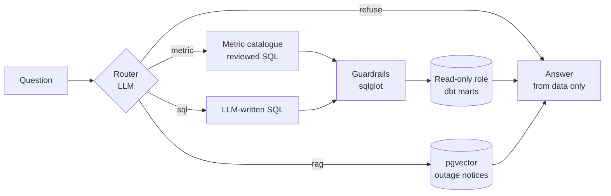

# Desk Copilot

**An AI analyst for an energy trading desk.** Traders and risk analysts ask questions in plain English ("Who is closest to their credit limit today?", "Why did NL residual load jump on Monday?") and get answers computed from governed data, never invented by the model.

> Status: in active development. The metric catalogue, SQL guardrails, golden set and their tests are in place; the LangGraph agent, API and retrieval are being wired to live data from [RiskLedger](https://github.com/beyzamercanse/riskledger) and [GridFlow](https://github.com/beyzamercanse/gridflow-energy-data-lakehouse).

## How it answers



1. **Route.** The model picks one of four paths: a catalogue metric, a guarded ad-hoc query, retrieval over outage notices, or a refusal.
2. **Govern.** Business definitions live in [`catalogue/metrics.yml`](catalogue/metrics.yml) as reviewed SQL. The model chooses a metric and its parameters; it does not redefine P&L or exposure.
3. **Guard.** Every query is parsed with sqlglot: one statement, SELECT only, allow-listed tables only, wrapped in a row limit, executed on a read-only role with a statement timeout.
4. **Answer.** The final answer is written only from the returned rows or passages; empty data means "no data", never a guess.

## Evaluation

[`evals/golden_set.jsonl`](evals/golden_set.jsonl) holds questions with the expected route, metric and parameters, covering all four paths, including a question that must be refused (VaR is not in the catalogue). `evals/run_evals.py` reports accuracy, median latency and mean cost per answer and fails below a threshold.

## Quickstart

```bash
pip install -e ".[agent,dev]"
cp .env.example .env            # add ANTHROPIC_API_KEY and ENTSOE_API_KEY
docker compose up -d            # Postgres + pgvector with a read-only role
python scripts/ingest_outages.py --zone NL --start 2026-01-01 --end 2026-06-30
uvicorn desk_copilot.api:app --reload
curl -s localhost:8000/ask -H 'content-type: application/json' -d '{"question": "Who is closest to their credit limit on 2026-06-30?"}'
pytest -q
```

## Roadmap

- [x] Metric catalogue over RiskLedger and GridFlow marts, with parameter checks
- [x] sqlglot guardrails: single SELECT, allow-listed tables, row limit, read-only role
- [x] Golden set covering metric, SQL, retrieval and refusal paths
- [x] LangGraph graph, FastAPI endpoint, pgvector schema, ENTSO-E outage ingestion script
- [ ] Load RiskLedger and GridFlow marts into Postgres for end-to-end runs
- [ ] Grow the golden set to 50 questions and run evals in CI with a stored API key
- [ ] Publish measured accuracy, latency and cost per answer in this README
- [ ] Optional: expose the marts through an MCP server with the same guardrails

## Layout

```
catalogue/      metrics.yml: governed metric definitions
src/desk_copilot/  agent.py (LangGraph), guardrails.py, catalogue.py, rag.py, db.py, llm.py, api.py
evals/          golden_set.jsonl, run_evals.py
sql/            pgvector schema and read-only role
scripts/        ENTSO-E outage-notice ingestion
tests/          pytest suite
```
